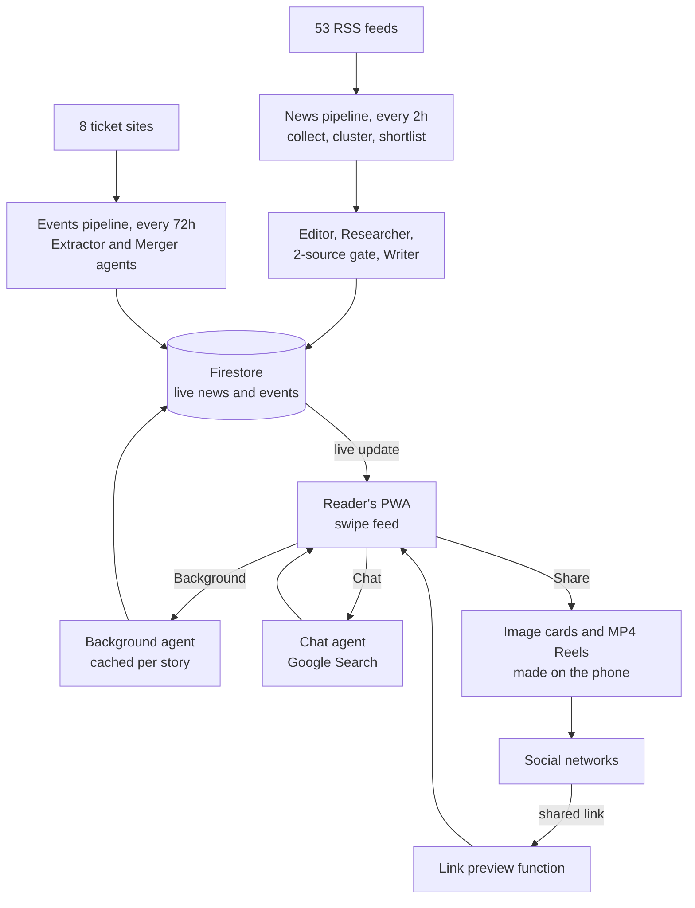
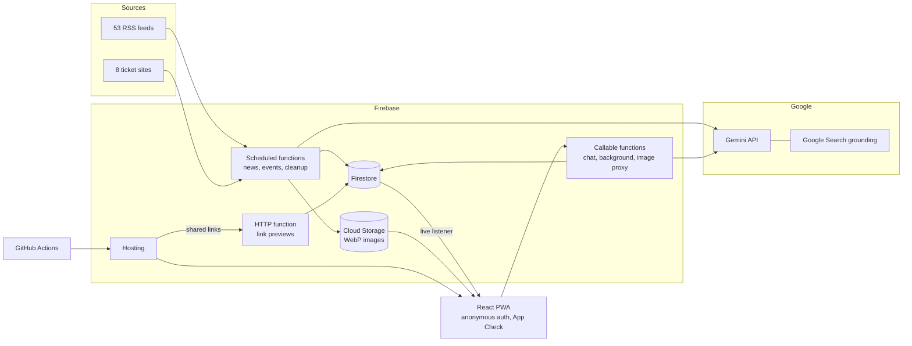

[← All products](../README.md)

# Nabrzinka

Macedonian news in one minute of scrolling, written by AI agents that check every story against at least two sources.

**Live:** https://nabrzinka.mk · **Launched:** January 2026 · **Built by:** Andrej Ivanov ([LinkedIn](https://www.linkedin.com/in/andrejivanov98))

> The source code is private. This repository documents what the product does and how it is built. I'm happy to walk through the code in an interview.

## At a glance

- **What it is:** a news and events web app with no journalists. Every two hours, AI agents pick the stories, check the facts and write each one as a 2–3 sentence card you swipe through like Reels.
- **Who it's for:** readers in North Macedonia who want to stay informed quickly and calmly. Macedonian is written in Cyrillic, local news is spread across dozens of portals, and much of it is crime and party politics, which the editor agent is told to skip unless it really matters.
- **Core value:**
  - **Short, verified news.** Each card is 2–3 sentences, built from at least two outlets, and gone after 24 hours. Half of every update is about Macedonia.
  - **Go deeper on demand.** A "Background" explainer and a chat that answers follow-up questions using live Google Search.
  - **Events in one place.** Upcoming concerts, shows and sport from 8 ticket sites, each listed once with all its ticket links.
  - **Share and privacy.** Any story becomes an image card or an MP4 Reel, made on the phone. There is no sign-up and no archive.
- **How AI is used:** seven Gemini agents: Editor-in-Chief, Researcher, Writer, Event Extractor, Event Merger, Chat and Background. Two guardrails matter most: a story needs two independent sources before the Writer runs, and the Writer sees only the Researcher's fact brief, never the source articles.
- **Stack:** React 19 PWA, Firebase (Cloud Functions, Firestore, Storage, Hosting), Google Gemini with Google Search grounding, GitHub Actions.

## Product flow, end to end

1. **Collect and shortlist (no AI).** Every two hours from 07:00 to 21:00 Skopje time, the backend reads 53 RSS feeds. It groups articles about the same event and drops stories already published today. Local scoring then picks 36 candidates.
2. **Choose, verify, write.** The Editor-in-Chief agent scores the shortlist, and code builds a run of up to 10 stories, half about Macedonia. For each story, the Researcher checks the facts with Google Search. Stories with fewer than two sources are dropped. The Writer turns each fact brief into a card with a headline, summary, category, three suggested questions, a social caption and three Reel lines.
3. **Publish.** Photos from the source articles are resized and stored, and the card goes into Firestore. Every open app shows it within seconds. Stories older than 24 hours are deleted with their images.
4. **Read.** The reader opens the site with no sign-up; the app signs them in anonymously in the background. They swipe up through full-screen cards and swipe sideways to Events. Tabs cover Newest, Most covered, Positive, "Did you know?" and 11 topics. Search works in Cyrillic and Latin script. Each card shows how many sources it was summarised from.
5. **Go deeper.** **Background** gives 2–3 sentences of context. It is generated the first time anyone asks, then cached for everyone. **Chat** starts from the suggested questions and answers in up to 60 words with live search, then suggests three more questions. Each reader can ask 30 questions a day.
6. **Events.** Every 72 hours, agents read the ticket sites and merge duplicates. Readers filter by Music, Art, Sport or Other, or by date range, and tap straight through to the ticket seller.
7. **Share.** Options include a cover image, a 4:5 story card, a chat answer card, a caption, a link, and a Reel in one of two styles: "In brief", or "Q&A", which answers a suggested question through the Chat agent. The reader picks photos for the Reel's three beats. The MP4 is encoded on the phone, with original synthesised music or silent for a trending track.
8. **Come back through a link.** When a social network opens a shared link, a function returns the headline, summary and photo as a rich preview. People who click land on that exact story, or see a note if it is older than 24 hours.

## AI agents and integration

| Agent | Model | Input → Output | Guardrail |
|---|---|---|---|
| Editor-in-Chief | Gemini 3 Flash (preview), JSON mode | 36 candidates and 80 recent headlines → scored longlist with category and an "about Macedonia" flag | Code checks IDs and categories, then enforces the 50% Macedonia quota and category caps |
| Researcher | Gemini 2.5 Flash + Google Search | Cluster headlines and today's date → plain-text fact brief and source list, or `SKIP` | Facts from the last 24h only. People's roles must be confirmed by a recent source. Feeds the 2-source gate |
| Writer | Gemini 3 Flash (preview), JSON mode | Research brief only → story card JSON | Never sees the articles. Cards with missing fields are dropped |
| Event Extractor | Gemini 3 Flash (preview), JSON mode | One ticket site's HTML → upcoming events | Fetch retries. A failed site returns nothing instead of breaking the run |
| Event Merger | Gemini 3 Flash (preview), JSON mode | All extracted events → one entry per event with all ticket links | Code checks title, date format and links. Falls back to exact-title dedup |
| Chat | Gemini 2.5 Flash + Google Search | Story, last 10 messages and question → short answer and 3 follow-ups | Auth required, 30 per day, 500-character limit, language guard |
| Background | Gemini 2.5 Flash + Google Search | Server-side headline and summary → 2–3 sentence context, or `SKIP` | Ignores client-sent text. Cached once for all readers. Language guard |

- **Plain SDK, no framework.** Every call goes through Google's `@google/genai` SDK. There is no agent framework, vector database or RAG index. Each agent is one call with its own instructions, and TypeScript passes data from one to the next.
- **Search and structure are separate calls.** Agents that need live facts use Google Search grounding and return plain text. Agents whose output code must parse use JSON mode with no tools.
- **Deterministic code between agents.** Quotas, category caps, the source count and output validation are plain functions, not prompt instructions. The model scores and writes. Code decides what ships.
- **Generate once, reuse everywhere.** The pipeline writes each card once for all readers. Background is cached per story, and the Q&A Reel reuses the Chat agent instead of a new prompt.
- **Language guard and fallbacks without AI.** If more than 15% of the letters in an answer are Latin, it is sent back for a Macedonian rewrite. If that also fails, chat shows a polite fallback, and Background caches the story as skipped. If the editor call fails, stories are ranked by source count and still go through the same quota code.

## Architecture

The backend is Firebase Cloud Functions in TypeScript. Scheduled functions run the news pipeline, the events pipeline and the daily cleanup. Callable functions serve chat, Background and an image proxy for share cards. One HTTP function renders link previews. All content lives in a few Firestore documents that the PWA reads through live listeners, and images live in Cloud Storage. The client never writes to the database.

News pipeline in brief:

1. **Collect:** parallel fetches with ETag and Last-Modified headers, so unchanged feeds are skipped. Articles from the last 6 hours only, and duplicate links across feeds are removed.
2. **Cluster:** word overlap between titles, with Cyrillic support and a simple stemmer. Each new title is compared against every title already in a cluster.
3. **Pre-filter and presort:** drop near-matches of today's headlines. Rank on source count (log scale), feed-type diversity and topic, filling separate Macedonian and international pools 60/40.
4. **Editor and quotas:** the agent scores a longlist of up to 20. Code fills the run of 10, one story per category first and never more than two per category.
5. **Research, gate, write:** batches of four stories in parallel. A story with fewer than two distinct outlets (RSS sources plus new domains from search) never reaches the Writer.
6. **Images and publish:** `og:image` from the grounding sources, up to 6 per story, resized with `sharp` to WebP. Then one Firestore write, plus deletion of expired stories, images and explainers.

## Key decisions

- **Business rules live in code, not in prompts.** The Macedonian share used to be a line in the editor prompt, and runs drifted international. Now the model only scores and labels, and a pure function enforces the split and the category caps every time.
- **Researcher and Writer are separate agents.** Each call does one job: search-grounded text for facts, JSON for structure. The Writer works only from a checked brief, never from raw articles or its own memory.
- **The trust gate runs before generation.** Single-source stories are dropped before the Writer runs, so no tokens are spent on stories that would be thrown away.
- **Content is generated once and served to everyone.** AI cost scales with the number of stories, not readers. Only chat and the first Background request per story call the model on demand.
- **The schedule and volume were tuned for cost.** The pipeline went from hourly to every two hours in daytime only, and from 15 to 10 stories per run. Events now refresh every 72 hours instead of 48. Conditional GETs and the local pre-filter let a quiet run end before any AI call.
- **Features that did not earn their place were removed.** A satire mode was cut after it was being generated for every story on every run. A later rebuild made it lazy and cached, and that was rolled back too. An audio briefing (Gemini text-to-speech), polls and a sponsored-story card were also built and removed.

## Reliability, cost, privacy and security

- **Bounded runs.** Fixed timeouts and memory per function. Image and cleanup failures never block publishing.
- **No archive.** News, images and explainers live for 24 hours and are deleted together. Past events drop off at each refresh.
- **Anonymous by design.** No accounts or profiles. A daily job deletes anonymous users inactive for 30 days. The only per-user data is a daily chat counter with an expiry field, which clients cannot read.
- **Locked-down rules.** Signed-in clients can read three Firestore documents, and everything else is denied, including all client writes. Storage denies client writes. App Check with reCAPTCHA v3 is set up on the client.
- **Hardened functions.** Chat limits are enforced in a Firestore transaction. Background takes only a story ID, so no one can poison the shared cache. The image proxy requires auth and HTTPS, blocks private and metadata hosts, uses a domain allowlist, and caps size and redirects.
- **Cheap delivery.** Hashed assets are cached as immutable. Video and music are produced on the reader's device, so there is no server media cost. GitHub Actions builds every push to `main` and every pull request, deploys `main` to production and puts pull requests on preview channels.

## Tech stack

| Area | Technology |
|---|---|
| Frontend | React 19, TypeScript, Vite, Tailwind CSS, installable PWA (`vite-plugin-pwa`) |
| Backend | Firebase Cloud Functions v2 (Node 20, TypeScript): scheduled, callable and HTTP |
| Data | Firestore (live listeners), Cloud Storage for WebP images |
| AI | Gemini 3 Flash (preview) and Gemini 2.5 Flash via `@google/genai`, Google Search grounding |
| Ingestion | `rss-parser`, `axios` with conditional requests, `sharp` |
| Security | Firebase Anonymous Auth, App Check (reCAPTCHA v3), Firestore and Storage rules |
| Sharing | `html-to-image`, `react-easy-crop`, Web Share API, Open Graph renderer |
| Video | Canvas, WebCodecs, `mp4-muxer`, Web Audio API (`OfflineAudioContext`), MediaRecorder fallback |
| Hosting and CI | Firebase Hosting, GitHub Actions |
