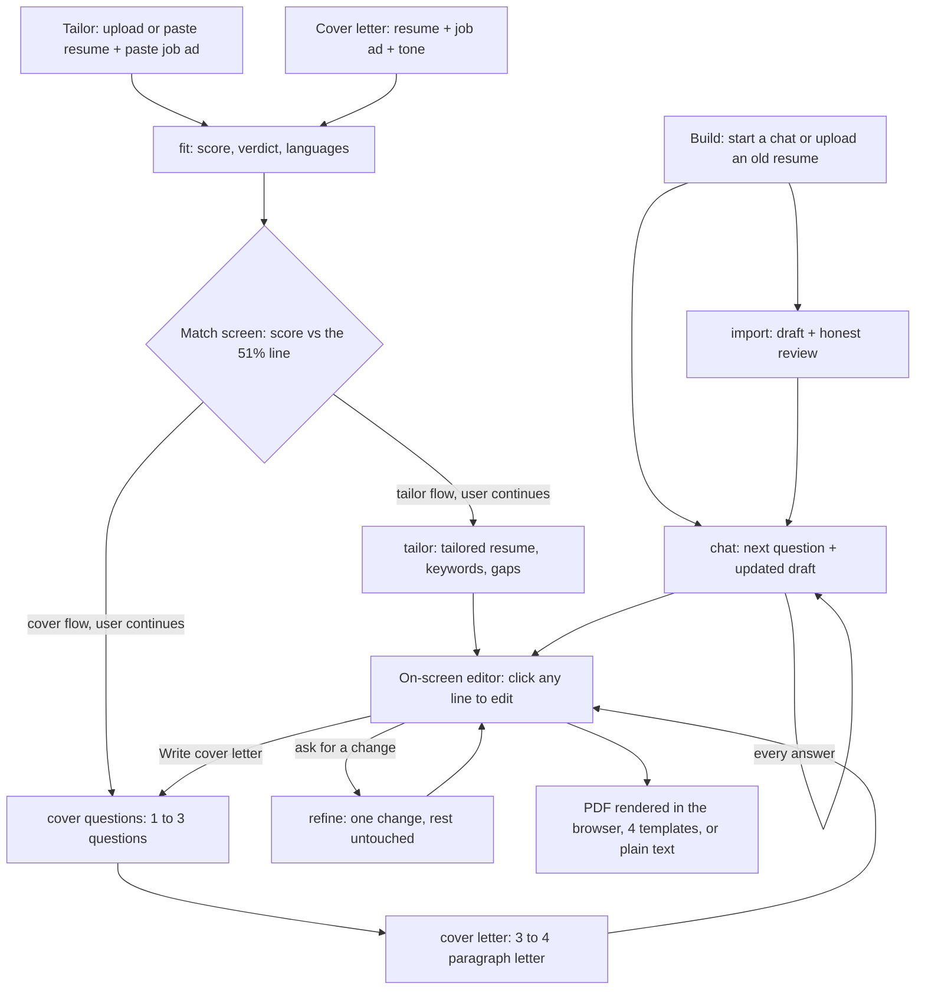
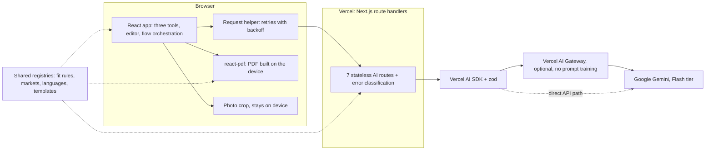

[← All products](../README.md)

# Resumco

Get your resume ready for a specific job: an honest match score first, then a tailored resume and cover letter that invent nothing.

**Live:** https://resumco.com · **Launched:** October 2026 · **Built by:** Andrej Ivanov ([LinkedIn](https://www.linkedin.com/in/andrejivanov98))

> The source code is private. This repository documents what the product does and how it is built. I'm happy to walk through the code in an interview.

## At a glance

- **What it is:** a one-screen web app that tailors a resume to a job ad, builds a resume from scratch in a short chat, or writes a matching cover letter, all with no sign-up.
- **Who it's for:** job seekers, especially in Europe, who apply to specific roles and need a document that passes applicant tracking systems (ATS) and still reads like a person wrote it.
- **Core value:**
  - Tailor a resume to a job, with an honest 0–100 match score shown *before* anything is written.
  - Build a resume in a short guided chat, or upgrade an old one, with a live preview.
  - Write a matching cover letter from your resume plus 1–3 short questions.
  - ATS-friendly PDFs in 4 templates, for 5 market standards, in English or German. Nothing invented, nothing stored.
- **How AI is used:** seven single-purpose endpoints, each one structured-output LLM call validated by zod, orchestrated by the browser. A fast fit-scoring call runs before the long rewrite, shared integrity rules forbid invented facts, and the model is swappable through config.
- **Stack:** Next.js 16, React 19, TypeScript, Tailwind CSS, Vercel AI SDK, Google Gemini (Flash tier), zod, react-pdf, mammoth, Vitest, Vercel.

I designed, built and shipped it alone, from the first commit in late June 2026 to the public launch in October 2026.

## Product flow, end to end

Every box with a lowercase name is one AI endpoint. Every response is checked against a zod schema before the browser uses it.

1. **Pick a tool.** A resume dropped on the landing page is carried into the tool in memory, never uploaded ahead of time.
2. **Score first.** For tailoring and cover letters, a fast call returns a 0–100 score, a verdict, the target role and the posting's language. Below 51% the app says so, names the real blocker and suggests better-fitting roles. The user can still continue.
3. **Choose the market and language.** Five standards (International, North American, UK & Commonwealth, Europass, German Lebenslauf). The output language defaults to the posting's language, English or German, and the resume and letter always share it.
4. **Tailor.** The rewrite returns the tailored resume, the changes it made, the keywords it worked in and the keywords still missing. Missing skills stay gaps; they are never added.
5. **Or build.** The chat asks one thing at a time, about 6–8 questions for a typical career, with one-tap quick replies. Each answer updates the full draft on screen. An uploaded old resume is mapped into the same draft first, with a short honest review.
6. **Or write the letter.** The user answers 1–3 personal questions and picks a tone (warm, confident or formal). The letter follows block format, or DIN 5008 order for a German letter.
7. **Edit and refine.** All three tools end in the same editor. Users click any line to change it, or ask in plain words ("add my AWS certification, 2024"). New facts only ever come from the user.
8. **Download.** The PDF is generated in the browser in one of four templates (Classic, Minimal, Modern, Compact), or the text is copied as plain text.

## AI agents and integration

There is no agent framework. Each "agent" is one stateless API route with its own system prompt, zod output schema and temperature. The browser passes one route's output to the next.

| Endpoint | Job | Input → Output | Temperature | Guardrail |
|---|---|---|---|---|
| `fit` | Score the match | resume + job ad → target role, score, achievable estimate, verdict, job and resume language | 0.4 | Shared scoring rules: never score location, nationality, age, gender or name; never penalise a career gap alone |
| `tailor` | Rewrite for the job | resume + job + market + language + score already shown → tailored resume, changes, keywords added and missing, before/after scores | 0.7 | Integrity rules; "before" pinned to the score shown; "after" never below "before"; withheld below 51% if no score was seen |
| `resume/refine` | Make one requested change | current resume + instruction + recent turns → reply, applied flag, changes, full resume | 0.3 | If the change needs a fact it doesn't have, it asks; the server then returns the original unchanged |
| `build/import` | Turn an old resume into a draft | resume file or text + market → draft, review message, section coverage | 0.5 | Maps real facts only; never marked complete |
| `build/chat` | Interview the user | whole conversation + current draft + market → next message, updated draft, coverage, quick replies | 0.6 | Unknown fields stay empty; conversation length capped |
| `cover/questions` | Pick personal questions | resume + job ad → 1–3 questions, target role, company | 0.4 | Must not ask what the resume already answers |
| `cover/letter` | Write the letter | resume + job + answers + tone + market + language → letter and score | 0.7 | Never invents a recipient name or address; withheld below 51% if no score was seen |

- **Structured output only.** Every route calls the Vercel AI SDK's `generateObject` with a zod schema, so the UI only ever receives typed, validated JSON. A deterministic cleanup step then normalises dates and strips characters text extractors mangle.
- **Native documents.** PDFs go to Gemini as file parts, so nothing is lost to a home-made parser. DOCX files are converted to text with mammoth.
- **Shared rule modules.** The 51% threshold, the scoring rules, the integrity rules, the "sound human" rules (keep the candidate's wording, no buzzwords like "spearheaded" or "leveraged") and the market and language registries live in single modules. Prompts, PDF renderers and UI all import them, so they cannot drift apart.
- **Server-side backstops.** Scores are reconciled so the user never sees two different "before" numbers. A refine that changed nothing returns the document the browser sent, not the model's copy of it.
- **Failure handling and privacy routing.** Failures are classified on the server as transient, refused or misconfigured. The client retries transient ones with backoff, up to three attempts. Every call asks Vercel AI Gateway to refuse providers that train on prompts.

## Architecture

The browser owns all state and orchestration; the server holds none. Each route validates its input, makes one model call and returns JSON. Nothing is written to disk or a database. The model ID is one environment variable, reached either directly or through AI Gateway, so it can be swapped with no code change. PDFs and photos are processed only in the browser, which is what makes "nothing stored" true by construction.

## Making "ATS-safe" testable

"ATS-safe" started as a claim in a comment. I turned it into a test suite. The tests render real PDFs with the production components and read them back the way a parser does: inflate the content streams, map glyphs to text through each font's ToUnicode table, and split words with the same half-a-space rule as Apache PDFBox. On every template they check that the PDF is real text, headings survive as single recognised words in English and German, contact details sit in the page body, text reads in one column in order, and no page ends on a heading.

**The font bug the tests caught.** The standard PDF fonts only cover Windows-1252. Polish, Czech, Turkish, Greek and Cyrillic names came out as the *wrong* letters, on the page and in extracted text, while German and French names looked fine. I switched to embedded DejaVu Condensed subsets with a ToUnicode map, cut to the characters all four template fonts share (about 125 KB per font instead of 700 KB). A regression test now reads those names back from the PDF.

## Key decisions

- **Score before writing → a poor match costs the user seconds, not effort.** The long rewrite runs only after the user has seen the score and chosen to continue.
- **Advisory gate, not a hard block → the decision belongs to the candidate.** The first version blocked tailoring below 60%. I replaced it with an advisory 51% line, because the model cannot see a referral or a planned career change.
- **Seven small endpoints orchestrated in the browser → no agent framework.** The flows are linear. Small calls with their own prompt, schema and temperature are easier to test and reason about than a framework.
- **One registry per concern → one source of truth.** Prompts, renderers and UI import the same rules, so a threshold or a section heading cannot disagree between screens.
- **One resume shape for all three tools → one editor, one renderer.** Tailor, build and import all return the same structure, so editing, refining and PDF export are shared.
- **Only standards I can cite → five markets, not fifty.** Each market profile records its sources. Anything else falls back to a neutral international format, not a guessed convention.

## Privacy and reliability

- No accounts, database, file storage, cookies or analytics.
- Files are processed in memory. Photos are cropped and re-encoded in the browser and never uploaded.
- Raw provider errors never reach the client or the logs; a log line keeps only the error class and HTTP status.
- Automatic retries for transient failures, then a clear message with a Try again button.
- Security headers on every response (clickjacking guard, nosniff, strict referrer policy, Permissions-Policy).
- Privacy and Terms pages rewritten to describe exactly what the app does, including how the model is reached.

## Tech stack

| Layer | Technology |
|---|---|
| App | Next.js 16 (App Router), React 19, TypeScript |
| Styling | Tailwind CSS v4 |
| AI | Vercel AI SDK, Google Gemini (Flash tier), optional Vercel AI Gateway |
| Structured output | zod |
| Document input | Native PDF to Gemini, mammoth for DOCX |
| Document output | @react-pdf/renderer, in the browser |
| Tests | Vitest: 223 tests across 18 files, all passing (prompts, schemas, fit rules, registries, retries, refine, PDF read-back) |
| Hosting | Vercel |

## What I'd do next

- **Live LLM evals.** Today's tests cover prompts, schemas and rules, not live model output. Next is an eval set of real resume and job pairs that measures score stability between runs and flags any invented fact.
- **Rate limiting and bot protection** on the AI endpoints, which are public and need no sign-up.
- **Privacy-friendly analytics**, aggregate and cookie-free, to see where people drop off.
- **End-to-end browser tests** for the three flows, on top of the unit and PDF tests.
