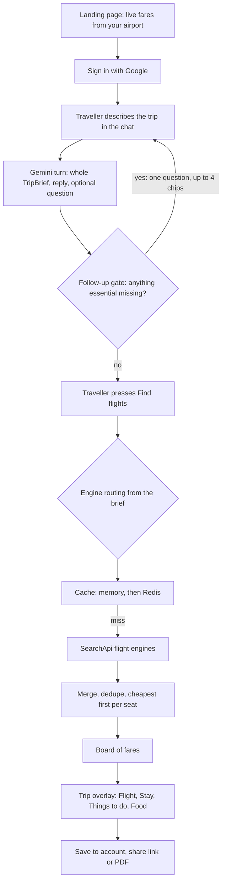
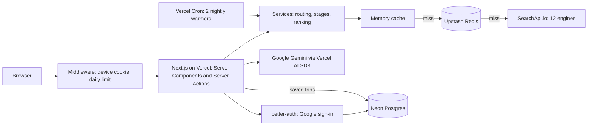

[← All products](../README.md)

# Triperco

**Travel More. Spend Less.** Describe a trip in one sentence and get the cheapest flight from your airport, plus a stay, things to do and places to eat for the same dates, with one total.

**Live:** https://triperco.com · **Launched:** July 2026 · **Built by:** Andrej Ivanov ([LinkedIn](https://www.linkedin.com/in/andrejivanov98))

> The source code is private. This repository documents what the product does and how it is built. I'm happy to walk through the code in an interview.

## At a glance

- **What it is:** A web app that turns one sentence about a trip into the cheapest flight from your airport, a room for the same nights, things to do and places to eat, all priced as one total.
- **Who it's for:** Flexible travellers who want to go somewhere and will pick the place when the price is right.
- **Core value:**
  - **Whole trip from one sentence.** Flight, stay, activities and food on the same dates, with one total in your currency (45 supported).
  - **Cheapest of everything.** Prices from many airlines and booking sites at once, sorted cheapest first. No destination needed: the board starts on "anywhere".
  - **Honest ordering.** A green savings badge appears only when a fare is measured below that route's usual price. Activities and food are ranked by rating, weighted by the number of reviews.
  - **No commission, nothing sponsored.** You book on the provider's own site. Free in beta. Trips can be saved, shared as a link or downloaded as a PDF.
- **How AI is used:** One structured-output call per chat turn fills a typed trip brief. The model only quotes places and months, and code resolves them against its own airport and region tables. No model touches a price. This design replaced an earlier tool-calling agent.
- **Stack:** Next.js 15 + React 19 + TypeScript on Vercel, Vercel AI SDK with Google Gemini and zod, SearchApi.io, Upstash Redis, Neon Postgres, better-auth.

## Product flow, end to end

1. **Landing.** A signed-out visitor sees live fares from an airport worked out from their coarse location, and can open one as a sample trip. The planning board needs a Google account.
2. **Chat.** The traveller types one sentence, such as "a cheap beach week in May for two". Each turn, the server sends the conversation to Gemini and gets back the whole trip brief: who, when, how long, kind of trip, place, budget.
3. **Follow-up.** Code checks the brief against a fixed checklist. If something essential is missing, the chat asks one short question with tap-to-answer chips. When nothing is missing, the **Find flights** button appears.
4. **Search.** The press writes the brief into the URL, so the board can be refreshed and shared. Code then picks the flight engines from the brief: a fixed date or a named place uses the explore engine; an open trip runs the explore and deals engines in parallel. The traveller's own words go to the deals engine as free text.
5. **Board.** Results come through a two-tier cache. They are merged, deduplicated and sorted cheapest first per seat. Fares measured below the route's usual price carry a savings badge.
6. **Trip stages.** Opening a fare starts a trip in one overlay: Flight → Stay → Things to do → Food. Each stage loads only when asked. The brief pre-selects the kind of room, activity and food, and chips let the traveller override. A price chart can move the whole trip to a cheaper day. The total stays on screen.
7. **Refine.** The traveller can keep talking ("actually, Berlin"). The model restates the brief, and **Update flights** rebuilds the trip around the change.
8. **Keep it.** Saving stores the trip in Postgres with the prices of that day. The traveller can mark each part as booked. A "getting around" plan between airport, room and chosen places is worked out in the background. A share link carries the trip inside the link itself. The PDF itinerary is built in the browser.

## AI agents and integration

There is essentially one AI step. The rest is deterministic code built around it.

| AI step | Model | Input → Output | Guardrail |
|---|---|---|---|
| Chat turn | Google Gemini (Flash) via Vercel AI SDK | Recent conversation + "trip so far" → whole `TripBrief`, one-line reply, optional question, chips | zod schema with closed enums; place and month resolved by code; hedged requests; 20 s deadline; cached 7 days |
| Sentence in a link | Same model, temperature 0 | A sentence arriving in a URL → `TripBrief` | 8 s timeout inside the page render; failure gives an empty brief with the sentence kept; cached 7 days |
| Follow-up gate | None (code) | Brief + questions already asked → next question, or "ready" | Fixed five-item checklist; max one question and four chips; never asks the same thing twice |
| Fallback | None (code) | Failed or timed-out turn → brief so far + the traveller's words | Search still runs; the panel says the message was not read |
| Planner agent (retired, Aug 2026) | Gemini with tool calling | Chat → tool calls that searched and edited a shared trip state | Replaced by the design above |

- **Structured output, not an agent.** Each turn is one `generateObject` call. The model calls no tools, sees no prices and cannot search. It restates the whole brief every turn, so a correction works like a new statement.
- **Closed vocabularies.** Trip type, occasion, companions, lodging kind and must-haves are zod enums from short lists the app defines. An open text field would let the model slip a recommendation into a description.
- **Grounding.** Place and month are quotations of what the traveller said. Code looks the place up in the app's own airport and region tables, and checks the month against what the provider can price. Anything unknown or invented resolves to nothing, so the model can't invent a destination, a date or a price.
- **Hedged requests.** In ten real conversations the median turn took about 4.7 s, with a long tail. If a turn has not answered after 7 s, or fails early, a second independent request starts. The first answer wins, the other is aborted, and both share one 20 s deadline.
- **Code decides when to stop.** The model writes the question; the checklist decides whether there is one. This is what makes the interview end.

## Architecture

| Layer | Job |
|---|---|
| `services` | Orchestration: reads the brief, routes to engines, applies domain rules, returns ready-to-show results |
| `providers` | One module per SearchApi engine, each normalising raw responses into one shared `Deal` shape, plus the cache |
| `domain` | Pure logic with no I/O: the brief, the follow-up checklist, ranking, filters, trip totals, share-link packing |
| `platform` | Infrastructure: database, abuse meter, cache warming, location and currency, the PDF writer |

Each layer only calls the layers below it. Each trip stage loads through its own server action, so the browser never talks to a provider and keys stay on the server. The 12 engines cover Google Flights (search, deals, explore, calendar), Google Hotels, Google Maps (places, reviews, directions) and Airbnb (stays, experiences, reviews).

## How the product evolved

- **July 2026, agentic chat planner.** A Gemini agent with tools, a live itinerary and a map. It narrated without acting and returned results from the wrong country. *Lesson: what must be true is enforced in code, not in a prompt.*
- **24 August, deals board.** The agent, tool loop and state machine were retired (the commit removed about 29,000 lines). *Lesson: a narrower design was more predictable and far cheaper to run.*
- **26 August, a trip from one cheap fare.** Separate boards became one flow that starts at a fare. *Lesson: the value is in connecting the steps.*
- **5–8 September, the trip brief.** Two flight boards exposed a provider boundary to users, so they became one board routed by a brief, filled through a short gated chat. *Lesson: users should never choose the engine; the model should only listen.*
- **10–11 September, accounts.** Google sign-in, trips in Postgres, device trips merged on first sign-in, and the board placed behind sign-in.

## Key decisions

- **No model in the price path → every number on screen can be checked.** Prices, ranking and badges come from providers and deterministic code.
- **Routing by provider capability → no greyed-out controls.** The deals engine finds discounts by moving dates and takes no date or destination, so fixed trips go elsewhere. Either engine can fail without taking the board down.
- **Cheapest first, per seat → the order can be checked by reading down the page.** The two engines quote party totals and seat prices differently, so results are compared per seat. Duplicates keep the copy that carries the saving.
- **Ratings judged per source → a new five-star tour doesn't outrank a famous landmark.** Ratings are weighted by review count, and Maps places and Airbnb experiences are each judged against their own norm. Stays below 4.0 stars or 50 reviews are never used to fill a slot.
- **Share links carry the trip in the URL fragment → nothing to store or leak.** Browsers don't send the fragment to the server, and the viewer recomputes the total.
- **A hand-written PDF writer → no 150–400 KB library for a button most visitors never press.**

## Reliability, cost, privacy and security

- **Cache.** Two tiers (memory, then Redis) with stale-while-revalidate, a shared upstream call for identical in-flight requests, 10-minute caching of empty answers, and versioned keys so a change in normalisation invalidates old entries. TTLs run from 3 hours (hotels) to 7 days (map places, AI answers).
- **Fixed provider spend.** Two nightly Vercel Cron jobs pre-fill results for 20 origin airports. The cron routes fail closed and refuse unauthenticated requests.
- **Abuse limits.** Middleware caps described searches at 500 per network address per day. Sign-in attempts are rate-limited in Redis.
- **Privacy.** Location is coarse and server-side, with no browser prompt. Google OAuth tokens are encrypted at rest. Users can delete their account themselves, as GDPR requires, and their saved trips go with it. Shared trips are never stored on the server.
- **Security headers.** Clickjacking is blocked, and search terms are kept out of referrers.
- **Tests.** 1,225 Vitest tests in 79 files (domain, services, providers and React components), all passing.

## Tech stack

| Area | Technology |
|---|---|
| App | Next.js 15 (App Router, Server Components, Server Actions), React 19, TypeScript |
| Styling | Tailwind CSS v4 |
| AI | Vercel AI SDK, Google Gemini, zod schemas |
| Travel data | SearchApi.io: 12 engines across Google Flights, Hotels, Maps and Airbnb |
| Cache and limits | Upstash Redis |
| Database | Neon Postgres |
| Accounts | better-auth with Google sign-in |
| Hosting | Vercel, including Cron Jobs |
| Tests | Vitest, Testing Library, jsdom |

## What I'd do next

- **An evaluation set for the brief.** Real trip sentences with expected briefs, tracking field accuracy, question quality and latency per model, so a model change is a measured decision.
- **Product analytics.** See where people drop off between sentence, board, trip stages and save.
- **End-to-end tests.** Browser tests for the full flow, from sign-in to a saved and shared trip.
- **Payments for the planned subscription.** The pricing page commits to a subscription, never a commission. That needs billing and plan-based limits on top of the per-address ceiling.
